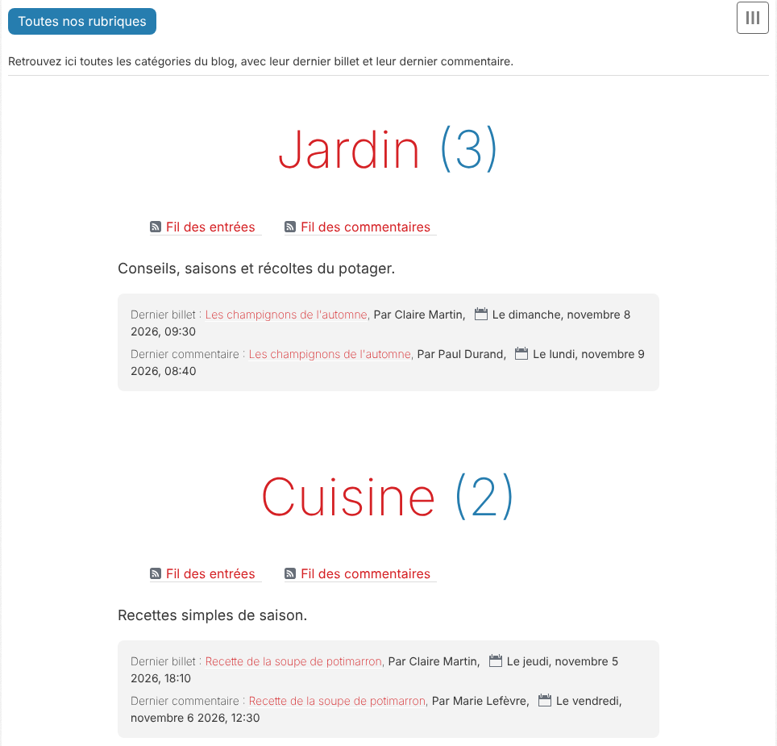
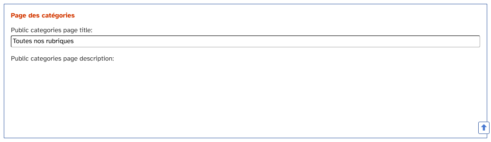
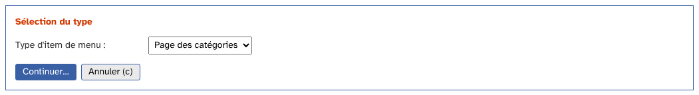
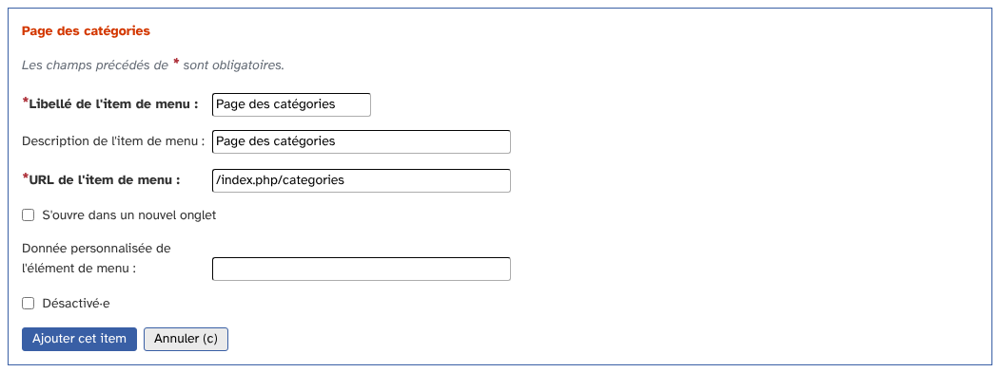
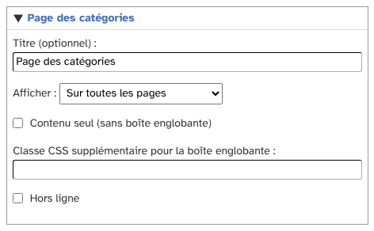
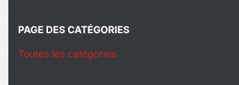

# Page des catégories : guide d'utilisation

Ce guide explique comment ajouter à votre blog une page publique qui liste toutes les catégories.

Ce plugin n'a pas de page d'administration. Ses réglages sont dans les paramètres du blog.

## Sommaire

* [À quoi sert le plugin](#à-quoi-sert-le-plugin)
* [La page publique](#la-page-publique)
* [Régler le titre et la description](#régler-le-titre-et-la-description)
* [Ajouter la page au menu](#ajouter-la-page-au-menu)
* [Le widget](#le-widget)
* [Modifier le gabarit](#modifier-le-gabarit)
* [Bon à savoir](#bon-à-savoir)

## À quoi sert le plugin

_Page des catégories_ crée une page à l'adresse `https://votre-blog/index.php/categories`.

Cette page liste chaque catégorie qui contient des billets, avec son nombre de billets, sa description, ses flux, son dernier billet et son dernier commentaire.

## La page publique

Voici la page sur le blog :

Pour chaque catégorie, on voit :

* le titre, avec le nombre de billets entre parenthèses, qui mène à la catégorie ;
* les liens vers le flux des entrées et le flux des commentaires ;
* la description de la catégorie (celle saisie dans _Blog_ puis _Catégories_) ;
* le dernier billet et le dernier commentaire.

Les catégories sans billet ne sont pas affichées.

## Régler le titre et la description

1. Allez dans _Blog_ puis _Paramètres du blog_.
2. Ouvrez la section _Paramètres des plugins pour ce blog_.
3. Remplissez le cadre _Page des catégories_.
4. Enregistrez.

* _Public categories page title:_ : le titre de la page. Si vous laissez vide, le titre est « Catégories ».
* _Public categories page description:_ : un texte affiché sous le titre. Il accepte du HTML. L'éditeur de billets s'applique à ce champ s'il est actif.

Ces deux libellés sont en anglais dans l'interface, même en français.

## Ajouter la page au menu

Le plugin ajoute un type d'item au plugin _Menu simple_.

1. Allez dans _Apparence_ puis _Menu simple_, et cliquez sur _Ajouter un item_.
2. Choisissez le type _Page des catégories_ puis _Continuer…_.

3. Le libellé, la description et l'adresse sont déjà remplis. Modifiez-les si besoin.
4. Cliquez sur _Ajouter cet item_.

## Le widget

Le widget _Page des catégories_ affiche un lien vers la page.

1. Allez dans _Blog_ puis _Widgets_.
2. Ajoutez _Page des catégories_ au volet de votre choix.
3. Réglez-le puis enregistrez.

* _Titre (optionnel)_ : le titre du widget.
* _Afficher_ : sur toutes les pages ou seulement en page d'accueil.
* _Contenu seul (sans boîte englobante)_ : supprime la boîte autour du widget.
* _Classe CSS supplémentaire pour la boîte englobante_ : ajoute votre classe CSS.
* _Hors ligne_ : cache le widget sans le supprimer.

Le texte du lien est « Toutes les catégories ». On ne peut pas le changer.

## Modifier le gabarit

Le plugin fournit deux gabarits (`categories.html`) : un pour le jeu de gabarits _dotty_ et un pour _mustek_. Ils sont dans le dossier `default-templates/` du plugin.

Pour changer la page, copiez le gabarit dans votre thème et modifiez-le.

Trois balises sont disponibles :

* `{{tpl:CategoriesPageTitle}}` : le titre réglé plus haut ;
* `{{tpl:CategoriesPageDescription}}` : la description ;
* `{{tpl:CategoriesPageURL}}` : l'adresse de la page.

Le bloc `<tpl:CategoryComments lastn="1">` boucle sur les derniers commentaires de la catégorie courante. Il se place dans un bloc `<tpl:Categories>`.

## Bon à savoir

* Le lien du widget ne mène à rien pour l'instant : il n'a pas d'adresse. Utilisez plutôt l'item de menu pour pointer vers la page.
* La balise `{{tpl:CategoriesPageURL}}` renvoie l'adresse du blog et non celle de la page. Écrivez l'adresse à la main dans vos gabarits : `{{tpl:BlogURL}}categories`.
* La page est ouverte à tous. Pour la cacher, supprimez simplement les liens qui y mènent.
